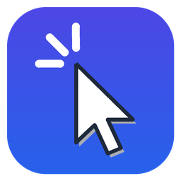

# Auto Clicker

A small left-click auto clicker for Windows 10 and 11. It's a single ~46 KB `.exe` with nothing to install. It runs on the .NET Framework that already comes with Windows.

## Download

Download **AutoClicker.exe** from the [latest release](https://github.com/TymonBitesTheDust/AutoClicker/releases/latest) and double-click it.

The app isn't code-signed, so the first time you run it Windows may show *"Windows protected your PC"*. Click **More info → Run anyway**.

## Features

- **Click interval**: hours, minutes, seconds and milliseconds, with a live "≈ clicks per second" readout
- **Single or double** left click
- **Repeat** a set number of times, or until you stop it
- **Cursor position**: wherever the mouse is, or a fixed point you choose with **Pick location** (the screen dims, you click the spot)
- **Global hotkey** to start and stop from any window. Default is **F6**, and you can pick any of F1–F12
- Optional **start delay** and **always on top**
- **Remembers your settings** between runs (`%APPDATA%\AutoClicker\settings.ini`)

## How to use

1. Set the interval (default 100 ms ≈ 10 clicks per second).
2. Choose whether to click at the current mouse location or a fixed spot.
3. Press **F6** (or click **Start**). Press **F6** again to stop.

## Notes

- If clicks don't register in a particular game or app, that app is probably running as administrator. Windows blocks input from normal apps into admin apps, so right-click `AutoClicker.exe` and choose **Run as administrator**.
- Clicks are sent with the Win32 `SendInput` API, and the timer uses 1 ms resolution while clicking so short intervals stay accurate.

## Build from source

You only need Windows. Run `build.bat`, which compiles `AutoClicker.cs` with the C# compiler included in the .NET Framework 4.x that ships with Windows, and writes `AutoClicker.exe` next to it.

The app is a single C# 5 / WinForms file (`AutoClicker.cs`), with `app.ico` as its icon.
